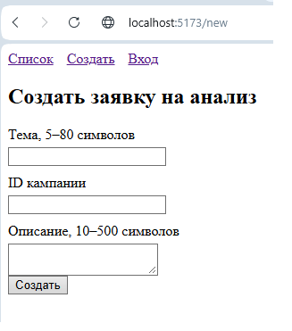

# Отчёт по ЛР4. Vue 3: компоненты и маршруты

**Тема:** Заявки на анализ рекламной кампании
**Студент:** Сахмантиев Никита Русланович
**Группа:** ТРИС-2-23

## Ход работы:

Каркас из ЛР3 разрезан на компоненты и страницы, подключён `vue-router`:

- Шапка `AppHeader` — снаружи `router-view`, видна на всех страницах.
- Три маршрута: `/` (список), `/new` (создание), `/login` (вход).
- Таблица вынесена в компонент `RequestTable` и получает данные через `props`.
- Общий массив заявок лежит в одном модуле `src/requestsStore.js`.

## Схема App.vue

```
App.vue
├── AppHeader ← всегда виден
└── router-view ← сюда подставляется текущая страница
```

## Дерево src/

```
src/
├── main.js ← app.use(router)
├── App.vue ← AppHeader + router-view
├── router.js ← три маршрута
├── requestsStore.js ← единственный общий массив
├── components/
│ ├── AppHeader.vue
│ └── RequestTable.vue
└── pages/
├── RequestList.vue
├── RequestNew.vue
└── Login.vue
```

## Таблица и данные

Таблица получает массив через props, источник — `requestsStore.js`.

`RequestTable.vue` объявляет:

```js
defineProps({
  items: { type: Array, required: true }
})
```

RequestList.vue передаёт:

```
<RequestTable :items="items" />
```

## Скриншот /new

