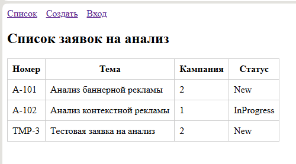
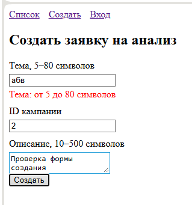
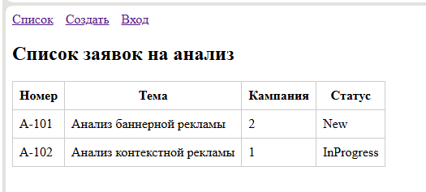

# Отчёт по ЛР5. Vue 3: форма и список в памяти

**Студент:** Сахмантиев Никита Русланович
**Группа:** ТРИС-2-23
**Тема:** Заявки на анализ рекламной кампании

## Что сделано

- Форма `RequestNew.vue` связана с состоянием через `v-model`.
- Для `campaignId` применён модификатор `.number` — значение хранится числом.
- Отправка через `@submit.prevent="onCreate"` — страница не перезагружается.
- После успеха форма очищается и происходит `router.push('/')`.
- Новая запись добавляется в общий массив `requestsStore.js` через функцию `addItem`.
- Статус новой записи всегда `New`.

## Три доказательства

| Проверка | Что делаю | Факт |
| :--- | :--- | :--- |
| Успех | тема ≥ 5, campaignId > 0, описание ≥ 10 | строка `TMP-3` со статусом `New` появилась |
| Отказ | тема `abc` | под полем «Тема» ошибка, строка не появилась |
| Память | F5 после успешного создания | добавленная строка исчезла |

Для F5: **ожидаемо — сервера и БД пока нет**, данные живут в памяти вкладки до перезагрузки.

## Скриншоты

## Ответы на контрольные вопросы

- **Зачем `.prevent`?** — Без него обычная HTML-форма при Enter отправится на сервер и перезагрузит страницу. `.prevent` останавливает перезагрузку и вызывает нашу функцию `onCreate`.
- **Почему у `campaignId` нужен `.number`?** — Без модификатора поле `<input type="number">` отдаёт строку `"2"`. `.number` преобразует в число `2`. Иначе проверка `Number.isInteger` и серверная валидация в ЛР8 сломаются.
- **Где хранится массив?** — В модуле `requestsStore.js`. И форма (`addItem`), и список (`items`) импортируют один и тот же массив.
- **Почему F5 очищает новые записи?** — Данные хранятся только в оперативной памяти вкладки. Постоянного хранилища (БД) пока нет. Это ожидаемое поведение до ЛР10.